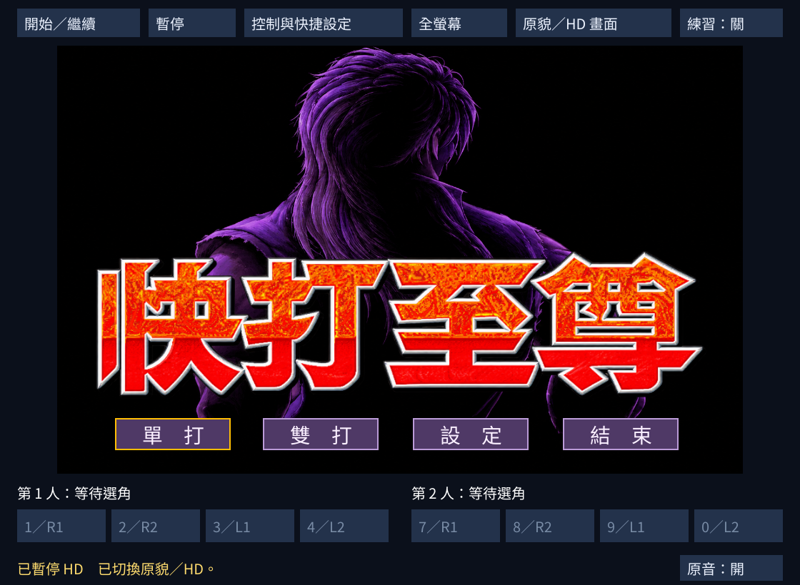
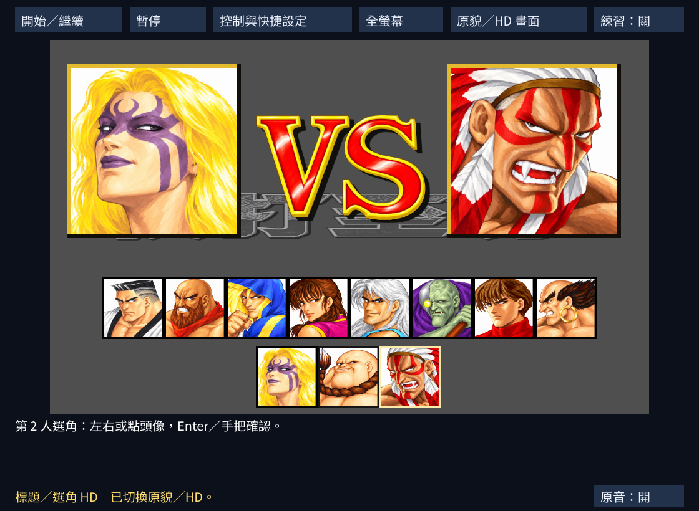
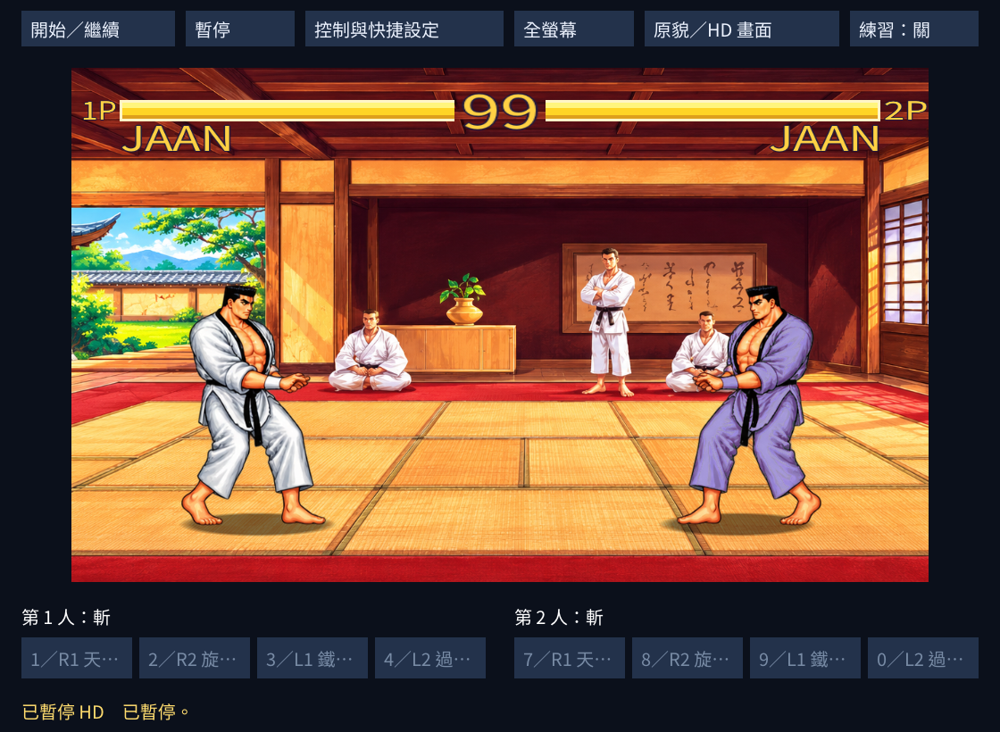
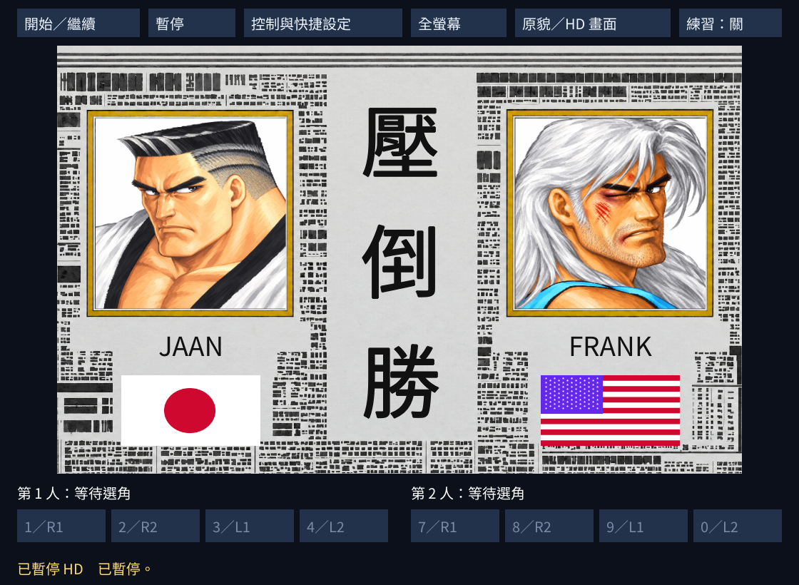
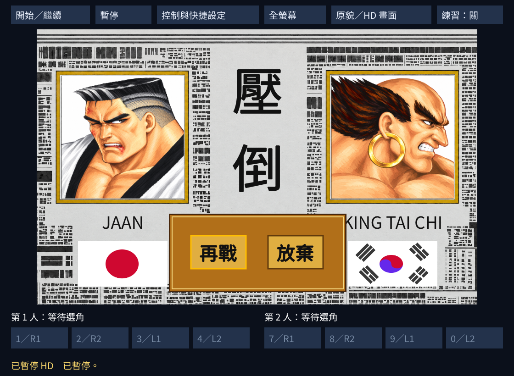

# 快打至尊 Remastered

Windows、macOS、Linux 原生桌面重製。以 dosgolem 執行原版核心，加入雙人手把、可重綁鍵盤、四格快速出招、練習模式與街機手繪 HD。

程式與 [HD 素材](assets/hd/README.md)存於 [GitHub 儲存庫](https://github.com/wicanr2/superfighter-remastered)。玩家須自備合法原版資料。原版 EXE、DAT、美術、音樂與語音不隨 Git 或引擎發行包提供。

## 遊戲與故事背景

《快打至尊》由台灣全崴資訊 C&E 開發，於 1993 年問世，是 DOS 時代的對戰格鬥遊戲。八名格鬥者各有招式與作戰場景，玩家在單打中逐一迎戰對手，也能由兩人直接對戰。年代與開發背景可查[官方歷史介紹](https://www.superfighter.com/)。

故事圍繞毒品集團及其殺手展開。他們暗殺政府高層，向世界宣示對自由的控制，引起聯合國恐慌。八名英雄接受挑戰，迎戰集團的三名頭目。這裡依[官方後來公開的故事介紹](https://www.superfighter.com/sf/index.html)整理；官方 2013 年版本另有新動畫與結局，本專案不將那些內容當成本機 DOS 來源已具備的功能。

本重製保留原版核心，增加原生操作、練習模式與可切換 HD。蜘蛛女、小丑、印第安喬已能在單打、雙打直接選用；完整魔王過關與結局仍待驗證。

## 目前整合範圍

目前本機修正版為 `v.1.0.1-20261021`，加入第二排魔王頭像與固定 60 fps 擷取節奏。視覺 HD 與原音播放已集中接入正式程式；既有正常路徑證據與限制保持。最新狀態見 [CONTEXT](CONTEXT.md)及[集中接入規格](docs/spec/049-hd-batch-integration.md)。

| 項目 | 現況 |
|---|---|
| 場景 | 十一景使用同一套載入與來源核對；街道、石窟、舞廳採保存的修稿，原背景相機與捲動不變 |
| 標題 | HD 人物、字標、四個選單按鈕與八相位色彩；設定頁保持原版 |
| 選角 | 上排八人、第二排三名魔王置中，十一個頭像均可點選；雙打沿原版先選第一人、確認後再選第二人，已移除畫面外的姓名按鈕 |
| 結果與接關 | 報紙、十一人勝敗肖像、七面旗幟、三類結果標題，以及單打再戰／放棄介面 |
| 對戰 | 十一人的一般與勝利來源、已驗光效、陰影、血條、計時、姓名、勝場與回合／勝負文字 |
| 原音 | 原 MIDI 軟體演奏與原四位元 PCM，沿原程式請求切歌、停音及播放語音；本機原音匯入與開關，見 [050](docs/spec/050-original-audio-playback.md) |
| 操作 | 兩人獨立裝置與鍵盤設定、四格招式配置；實際快捷出招目前只開放已驗的斬四招 |

蜘蛛女已依使用者選擇統一為全覆蓋紫色連身衣，144 個一般／WIN 入口使用同套服裝。原版十五段 MIDI 與四十段語音／音效已接入 OGG 播放。未知動作、來源或色盤沿用整格原貌回退。完整動畫與魔王單打過關、結局仍待驗收。實體手把與 Windows／macOS 真機見[人工清單](WORKLIST.md#人工驗證)。

HD 為獨立呈現層。規則、碰撞、AI 與原版流程由 dosgolem 執行；手繪造型、現代字型與材質換色是美術近似，不宣稱逐像素忠實。

## 整合畫面

以下截圖來自正式來源的 Linux 原生程式，經正常選單進入，未改生命、勝負或亂數。圖片與[截圖來源紀錄](docs/screenshots/source.json)均在儲存庫內；原貌對照及原始收據只留本機。



標題保留原版四個選項與操作位置。字標的色彩循環投影到新美術，設定頁仍顯示原貌。



三名魔王置中排列在第二排，可直接點頭像選用。圖中為雙打第二人選角，兩側大肖像跟隨原選角狀態；下方只顯示操作提示。



道場由正常雙打進入，畫面顯示兩套角色配色、HD 介面與陰影。此圖只代表該場景的取樣。


蜘蛛女一般與 WIN 圖格統一使用 B 版連身衣。圖格基底依原 DAT 朝左，遊戲依站位翻轉；右下角可切換原音。



結果保留左右玩家位置，以各自勝敗肖像顯示勝者；字型、旗幟與報紙為重畫近似。



這張來自原版 AI 正常取得兩勝後的接關畫面。再戰回選角、放棄回標題，原選取位置與輸入保持。


## 下載與資料準備

已發布的 `v.1.0.0-20261021` Windows x86-64、Linux x86-64、macOS Intel 與 Apple Silicon 引擎包見 [v1 正式 Release](https://github.com/wicanr2/superfighter-remastered/releases/tag/v.1.0.0-20261021)。儲存庫為私人，需有權限的帳號查看。本輪 `v.1.0.1-20261021` 為本機修正版，尚未新增 Release；已發布附件與 tag 保持。

1. 解壓對應平台的引擎包。
2. 以 `-import-data 原版目錄或jsdos檔 -data game-data` 匯入合法資料。工具逐檔核對，只建立新目錄，不覆寫既有資料。
3. Windows 執行 `Start.cmd`；Linux 執行 `Start.sh`；macOS 開啟 `Superfighter Remastered.app`。
4. 按「開始／繼續」，再按「原貌／HD 畫面」切換。

程式從封包旁的 `assets/hd/` 載入素材，並在使用者設定目錄由自己的原版資料建立背景參考。正式載入不依賴研究目錄、Python 或本機原型環境變數。

本機修正版八包位於 `dist-all/v.1.0.1-20261021/`：四個引擎包與四個含原版／原音的完整版。該版 `promo/` 保存新版 60 fps 推廣片，75 秒中包含 66 秒原生 GPU 實錄，展示三名魔王的第二排頭像選角與實際對戰，含原版音樂及音效。完整版與影片只留本機，不隨 Git 或 Release 提供。交付內容與限制見[發行契約](docs/spec/036-release-packages.md)。

目前來源與 `workplace/bin/` 已再移除額外的姓名／確認按鈕；既有八包及影片保持前輪定版，這項介面修正尚未重新打包。

流暢度目標為穩定 60 fps 輸出，保留原版動作節奏。ada 的 RTX 2000 Ada 在固定節奏下，二十秒邊玩邊錄影約 60.02 fps，1,202 個畫格間隔中沒有超過 33.3 ms 的停頓。這是 Linux／NVIDIA EGL 擷取路徑的抽樣，實體螢幕及其他平台仍須驗收；原版完成畫格與輸出 FPS 分開記錄，定義見[原生桌面規格](docs/spec/005-native-desktop.md#60-fps-流暢度目標)。

錄影或虛擬顯示環境可加 `-capture-fps 60`，以固定呈現節奏取代該擷取路徑的垂直同步等待。一般啟動保留螢幕垂直同步，遊戲計時與輸入規則維持。

原音可用 `-import-audio OGG目錄` 匯入完整 55 段來源驗證包，或以 `-audio-assets` 指定。右下角「原音」控制靜音，未匯入時明示；準備工具與固定 Docker 音源見[音樂與語音評估](docs/audio-hd-assessment.md#本機準備與使用)。本機完整版會自動載入原音。

## 操作

按「開始／繼續」，由原版標題進單打或雙打。「控制與快捷設定」可指派兩人裝置、切換要設定的角色與四招，以及重綁鍵盤；設定角色不改變原版選角。

標題選「雙打」後，先選第一人，確認後再選第二人。HD 可點十一個頭像或用左右方向選人，再按 Enter、數字鍵盤 Enter 或手把確認鍵；原貌使用原選角操作。三名魔王在單打、雙打都可選。舊八人設定保留原配置並補上魔王欄位；蜘蛛女只有兩招，其餘預設留空。魔王快捷仍待逐招驗證。

| 輸入 | 第一人 | 第二人 |
|---|---|---|
| 方向 | QWE／A D／ZXC | 數字鍵盤 789／4 6／123 |
| 拳 | Tab | Enter |
| 腳 | 左 Shift | 右 Shift |
| 手把拳／腳 | 西側／南側面鍵 | 同左，另行指派裝置 |
| 快捷 | R1／R2／L1／L2 預設招式 1／2／3／4 | 各自保存角色配置 |
| 鍵盤快捷 | 主鍵盤 1／2／3／4 | 主鍵盤 7／8／9／0 |
| 暫停 | Esc 或手把 Start | 共用對局 |
| 練習模式 | F9 或工具列「練習：關／開」 | 共用對局 |
| 設定 | F10 開啟，F8 切頁，Tab 選欄，Esc 關閉 | 同左 |

每名角色最多四格，可選第五招或留空。快捷按住不連發，投技仍須近身。視窗失焦會暫停；手把斷線清除該玩家指派及輸入，重接後需再次指派。

練習模式可在選單預先開啟，也可在戰鬥中切換。啟用後雙方補滿並鎖住滿血、停止倒數，電腦不再主動操作；受擊、擊退、倒地與站立動畫保留，雙打仍可操作兩邊。關閉後恢復扣血、倒數及 AI，生命從當下滿血繼續。已判定勝負的回合等待下一回合啟用。

加上 `-training` 可在啟動時預選練習模式。開關只保留本次執行，重啟預設關閉；練習模式的診斷與截圖會標示已修改規則，驗證範圍見[練習模式規格](docs/spec/032-training-mode.md)。

設定與可寫 DOS 資料存於作業系統的 `SuperfighterRemastered` 使用者設定目錄，可用 `-user-data` 改位置。原始資料維持唯讀。

## 建置與執行

共用主機的建置、測試與遊戲執行均在 Docker 內。需另行準備本專案 dosgolem 副本與固定工具鏈，入口見 [AGENTS](AGENTS.md)及[桌面規格](docs/spec/005-native-desktop.md)。儲存庫不附私有執行器來源、原版或快取；`go.work.example` 記錄相對配置。

```sh
bash tools/build_desktop.sh
```

此腳本在容器內建立四個中間二進位，輸出至 `workplace/bin/`：

| 平台 | 檔案 |
|---|---|
| Linux x86-64 | `superfighter-linux-amd64` |
| Windows x86-64 | `superfighter-windows-amd64.exe` |
| macOS Intel | `superfighter-macos-amd64` |
| macOS Apple Silicon | `superfighter-macos-arm64` |

玩家在自己的電腦執行對應程式，以 `-data` 指定合法資料。例如 Windows：

```powershell
.\superfighter-windows-amd64.exe -data .\game-data
```

自訂素材可用 `-hd-assets` 指定已驗背景包、`-hd-characters` 指定角色包、`-hd-screens` 指定含 `screens.json` 的畫面素材目錄。舊版屋頂包仍可讀取。缺件或來源不符時回退原貌。

玩家 ZIP 由 `tools/package_release.py` 建立。Linux／Wine 的執行收據與 macOS 的編譯、檔頭檢查分開記錄；Wine 不代表 Windows 真機，macOS 尚未簽章或作真機驗收。

## 文件

- [工作契約與索引](AGENTS.md)、[目前狀態](CONTEXT.md)、[工作清單](WORKLIST.md)、[工作歷程](WORKLOG.md)。
- [驗證矩陣](VERIFICATION-MATRIX.md)、[研究證據](RESEARCH-LOG.md)、[集中 HD 規格](docs/spec/049-hd-batch-integration.md)。
- [素材來源、提示詞與狀態](assets/hd/README.md)、[青衫與 SP Moves 歷史保存](docs/game-history.md)。
- [鍵盤與快捷範圍](docs/spec/035-keyboard-bindings.md)、[魔王選角](docs/spec/025-boss-selection.md)、[音樂與語音評估](docs/audio-hd-assessment.md)。

自有程式與文件採 [RRSAL-1.0](LICENSE)，為 source-available 專案。此授權不涵蓋原版遊戲、外站原文與圖片或衍生美術；玩家須自備合法原版。專案與原版權利人沒有隸屬關係。內嵌中文字型另依 [SIL Open Font License](internal/desktop/assets/OFL.txt) 使用。
