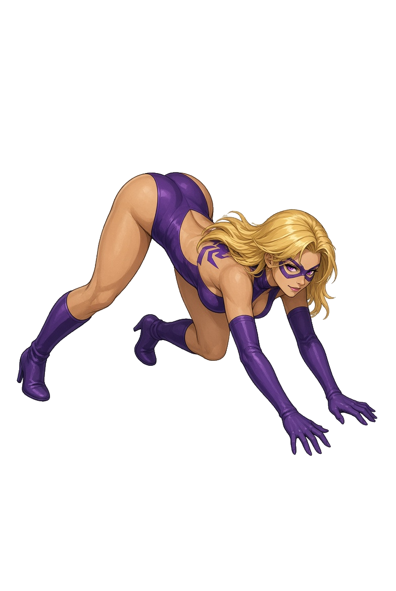

# 蜘蛛女 HD 候選

收錄兩批共十五張已去背的外部模型生成圖。PNG 與本地去背成品逐檔相同，未在匯入時縮放、翻轉或重新編碼。原始輸入雜湊、去背工具版本及逐檔狀態見 [source.json](source.json)。模型名稱與版本未由提供者註明。

這個目錄是候選素材索引，不能直接作為 `-hd-characters` 的執行期角色包。原檔名只保留輸入標籤，不表示已通過原版動作對應。正式接入進度見 [CONTEXT](../../../../CONTEXT.md)。

## 第一批圖集

| 圖片 | 目視內容與格數 | 狀態 |
|---|---|---|
| [poses-00](atlases-v1/spider-poses-00.png) | 三欄三列，九格 | 與原交接要求的十二格不同 |
| [poses-01](atlases-v1/spider-poses-01.png) | 四欄三列，十二格低姿態 | 倒地及翻轉來源另缺，需逐格對應 |
| [poses-02](atlases-v1/spider-poses-02.png) | 五張站立勝利姿態 | 不能按檔名當作第三批一般動作；原勝利前段仍低伏 |
| [poses-03](atlases-v1/spider-poses-03.png) | 四欄三列，十二格 | 與原交接要求的九格不同 |
| [win](atlases-v1/spider-win.png) | 四欄三列，十二格一般動作 | 不能按檔名當作五格 WIN 來源 |

## 第二批單張補稿

| 檔案 | 目視內容 | 對應審查 |
|---|---|---|
| [normal-00](cels-v2/spider-normal-00.png) | 正面低位跪伏 | 低姿態候選，朝向及肢體角度待核對 |
| [normal-01](cels-v2/spider-normal-01.png) | 雙手觸地低伏 | 低姿態候選，朝向及肢體角度待核對 |
| [normal-21](cels-v2/spider-normal-21.png) | 俯臥，一腿抬起 | 倒地候選，腿部姿態與原圖待核對 |
| [normal-24](cels-v2/spider-normal-24.png) | 彩色水平細條 | 原槽 24 為蜷身倒轉，不對應 |
| [normal-29](cels-v2/spider-normal-29.png) | 空中蜷身 | 原槽 29 為橫向倒地，不對應 |
| [normal-33](cels-v2/spider-normal-33.png) | 跪蹲 | 原槽 33 為斜向仰身，不對應 |
| [normal-34](cels-v2/spider-normal-34.png) | 橫向俯臥 | 原槽 34 為倒轉斜身，不對應 |
| [normal-41](cels-v2/spider-normal-41.png) | 仰身空中姿勢 | 原槽 41 為低伏，不對應 |
| [normal-43](cels-v2/spider-normal-43.png) | 紫黃色尖形特效 | 原槽 43 為 94×1 細長來源，不對應；原用途未定 |
| [normal-44](cels-v2/spider-normal-44.png) | 空中人物姿勢 | 原槽 44 為黃色輪廓效果，不對應 |

以上是目視審查，不把相似姿勢當成原版動畫證據，也未根據檔名自動登錄。現行遊戲仍保留蜘蛛女原貌。一般來源與 WIN 的別名必須依原始 packed bytes 核對，不能把站立圖任意塞進低伏或倒地槽。

這是候選圖預覽，並非實機整合截圖。此處只公開外部生成圖的去背成品及來源索引，原版參考圖、原始資料與研究收據不隨目錄提供。去背及匯入工具分別為 [remove_sprite_checkerboard.py](../../../../tools/remove_sprite_checkerboard.py) 與 [import_spider_candidates.py](../../../../tools/import_spider_candidates.py)。
